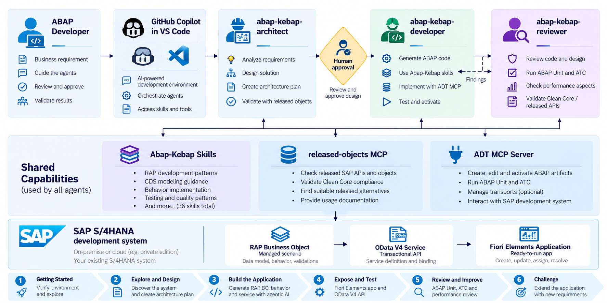

# Agentic ABAP - Build a RAP App with an AI Development Team

## Description

This repository contains the material for a **2-hour hands-on workshop** for experienced ABAP developers.

You will build a transactional SAP Fiori elements application for **Service Request Management** on a **SAP S/4HANA development system** using the **ABAP RESTful Application Programming Model (RAP)** from **Visual Studio Code**.

The workshop assumes the following capabilities are **already installed and configured before the session starts**:

- ABAP Development Tools for Visual Studio Code
- GitHub Copilot
- `abap-kebap-architect`
- `abap-kebap-developer`
- `abap-kebap-reviewer`
- the Abap-Kebap skill catalog
- ADT MCP Server access to the workshop SAP system
- `released-objects` MCP, when release/Clean Core evidence is part of the workshop setup

> [!IMPORTANT]
> This repository does **not** ship, install, configure, or duplicate agents, skills, or MCP servers. They are external workshop prerequisites.

> [!IMPORTANT]
> This is a community workshop repository. It intentionally follows the instructional style of SAP TechEd hands-on repositories, but it is **not an official SAP sample**.

> [!NOTE]
> This workshop is **S/4HANA target-adaptive**. The instructor must provide the actual S/4HANA edition, release, and ABAP language version used in the room. Do not assume SAP S/4HANA Cloud Public Edition.

**Table of Contents**
- [Level](#level)
- [Overview](#overview)
- [Prerequisites](#prerequisites)
- [Exercises](#exercises)
- [Known Issues](#known-issues)
- [How to obtain support](#how-to-obtain-support)
- [Further Information](#further-information)
- [Contributing](#contributing)
- [License](#license)

## Level

🧑‍🎓 **Intermediate.** Participants should already understand ABAP objects, CDS basics, and the purpose of RAP.

## Overview

The workshop uses a role-based AI development flow:

- **`abap-kebap-architect`** designs the RAP solution before code is written.
- **`abap-kebap-developer`** implements the approved design and performs the live SAP development work.
- **`abap-kebap-reviewer`** independently reviews correctness, maintainability, security, and performance risk.
- **Skills** provide reusable ABAP/RAP/CDS guidance to the installed agent team.
- **ADT MCP Server** provides live development capabilities against the SAP system.
- **`released-objects` MCP** provides target-aware release/Clean Core evidence when applicable.

### Resulting application

You will create a managed RAP **Service Request Manager** with a single root business entity and the following behavior:

| Area | Result |
|---|---|
| Data | Request ID, title, description, priority, status, requester, assignee, due date, audit fields |
| Transaction | Create, update, delete |
| Actions | `AssignToMe`, `Resolve` (popup with required comment) |
| Rules | Mandatory title, default status/priority, assignment required before resolve, only the assignee can resolve |
| UI behavior | Resolve enabled only for the assignee; list rows coloured red / orange / green by status |
| UI/API | OData V4 UI service and Fiori elements preview |
| Quality | ABAP Unit, ATC, independent reviewer pass |

### Workshop principle

> **Don't ask AI to generate ABAP. Give an AI development team a requirement and supervise how it delivers it.**

## Prerequisites

The instructor-provided workstation or participant environment must already contain the required AI and MCP setup. Participants do not install or copy those components from this repository.

You only need the workshop repository plus:

- access to the assigned SAP S/4HANA development system,
- an instructor-provided participant number `###` (e.g. `001`),
- your own package `ZAI###`, created by you under the shared parent package `ZAI_DEMO`,
- an instructor-provided transport request,
- working access to the preinstalled agent team and toolchain.

### Naming at a glance

| What | Rule | Example for `001` |
|---|---|---|
| Parent package | `ZAI_DEMO` (exists) | `ZAI_DEMO` |
| Your package | `ZAI###` | `ZAI001` |
| Hand-written objects | `ZAI###_...` | `ZAI001_CL_SREQ_RULES` |
| RAP generator | prefix `AI`, suffix `###` | generator adds the leading `Z` |

## Exercises

Follow the step-by-step instructions below. Replace every occurrence of **`###`** with your assigned participant suffix.

### Core Exercises

| Exercise | Outcome | Suggested Time |
|---|---|---:|
| [Getting Started](exercises/ex0/README.md) | Open the workspace, connect to SAP, create participant context, and verify prerequisites. | 10 min |
| [Exercise 1: Verify Live Tool Access](exercises/ex01/README.md) | Prove read-only access to the live SAP system and target-aware evidence before any write. | 10 min |
| [Exercise 2: Design the RAP Solution with the Architect](exercises/ex02/README.md) | Produce options, select a design, and create a human approval gate. | 15 min |
| [Exercise 3: Generate the RAP UI Service with the Developer](exercises/ex03/README.md) | Create, activate, publish, and preview the first working application. | 35 min |
| [Exercise 4: Add Business Behavior](exercises/ex04/README.md) | Add actions, validations, defaults, and a testable rules helper. | 20 min |
| [Exercise 5: Test, ATC, and Independent Review](exercises/ex05/README.md) | Generate tests, run quality checks, review, and close one fix loop. | 20 min |

### Optional / Fast-Finisher Exercise

| Exercise | Outcome | Suggested Time |
|---|---|---:|
| [Exercise 6: Intent-Only Team Challenge](exercises/ex06/README.md) | Give a new business requirement to the installed agent team without implementation instructions. | 10 min |

## Known Issues

- Coding-agent outputs are non-deterministic. Generated object names and implementation details can differ from the examples. **Review every proposed SAP change before approving a write.**
- MCP tool names and capabilities can differ between installed ADT for VS Code releases. Let the agent discover the available tools instead of relying on a hard-coded tool name.
- If an MCP server or agent is unavailable, treat it as an environment/preflight problem. Do not copy replacement implementations into this repository during the workshop.
- ADT MCP access restrictions can block writes outside the assigned destination/package. If a write is blocked, verify the participant number and package rather than broadening the boundary.
- The RAP generator prepends `Z` to its prefix and ignores requested field lengths. Always read what it created before building on it (Exercise 3.3).
- `released-objects` with `target: auto` can resolve to a different, previously logged-on system. Use the explicit target from `workshop/participant.json`.
- Running two ADT edits on the same object in parallel can silently drop one of them or fail with `LOCK_FAILED`. Edit one object at a time and re-read the active version.
- "Activated" is not "works". For UI behavior, check the service `$metadata` or the preview, not only the activation result.

## How to obtain support

For an instructor-led session, raise your hand and provide the exercise number and the last prompt/tool call shown in Chat.

For a self-paced repository, use GitHub issues and include your ADT for VS Code version, target system type, exercise number, and a sanitized error message.

## Further Information

- [ABAP Development Tools for Visual Studio Code](https://help.sap.com/docs/abap-cloud/abap-development-tools-for-visual-studio-code/abap-development-tools-for-visual-studio-code)
- [Agentic AI Development for ABAP](https://help.sap.com/docs/abap-cloud/abap-development-tools-for-visual-studio-code/agentic-ai-development)
- [Model Context Protocol Tools](https://help.sap.com/docs/abap-cloud/abap-development-tools-user-guide/model-context-protocol-tools)
- [ABAP RESTful Application Programming Model](https://help.sap.com/docs/abap-cloud/abap-rap/abap-restful-application-programming-model)
- [ABAP Cloud](https://pages.community.sap.com/topics/abap/abap-cloud)
- [GitHub Copilot custom agents in VS Code](https://code.visualstudio.com/docs/copilot/customization/custom-agents)
- [Agent Skills in VS Code](https://code.visualstudio.com/docs/copilot/customization/agent-skills)

## Contributing

See [CONTRIBUTING.md](CONTRIBUTING.md).

## License

Workshop content is provided under the MIT License unless explicitly noted otherwise. See [LICENSE](LICENSE), [LICENSES](LICENSES), and [THIRD_PARTY_NOTICES.md](THIRD_PARTY_NOTICES.md).
