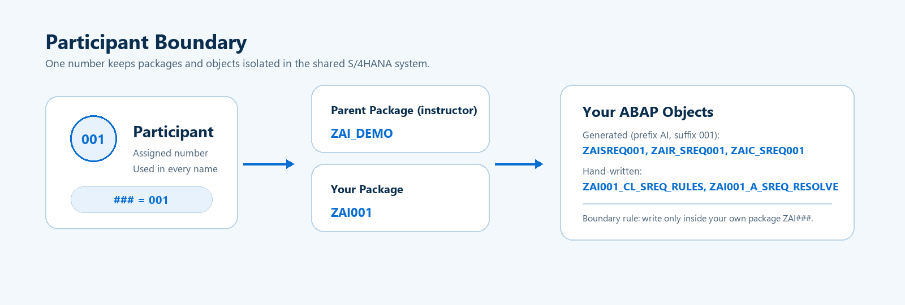
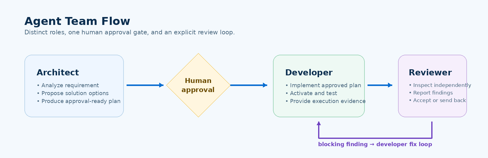

[Home - Agentic ABAP Workshop](../../README.md)

# Getting Started

## Introduction

Before building the application, you will identify your participant suffix, open the workshop repository, connect Visual Studio Code to the assigned SAP S/4HANA development system, and verify that the **preinstalled** AI toolchain is available.

> [!IMPORTANT]
> Agents, skills, and MCP servers are prerequisites. This repository does not contain installation or configuration copies of them.

---

**Table of Contents**
- [Important Information](#-important-information)
- [System and Participant Information](#-system-and-participant-information)
- [Exercises](#exercises)
- [Summary & Next Exercise](#summary--next-exercise)

---

## 🔴 Important Information

> [!IMPORTANT]
> Replace every occurrence of **`###`** with your assigned three-digit participant suffix.

Example for participant `001`:

| Item | Workshop Pattern | Example |
|---|---|---|
| Parent package (exists, instructor-owned) | `ZAI_DEMO` | `ZAI_DEMO` |
| Your package (you create it under `ZAI_DEMO`) | `ZAI###` | `ZAI001` |
| Prefix for hand-written objects | `ZAI###_` | `ZAI001_CL_SREQ_RULES` |
| RAP generator settings | prefix `AI`, suffix `###` | prefix `AI`, suffix `001` |
| Transport request | instructor-provided | `<TRKORR>` |

> [!IMPORTANT]
> Every object you create lives in **your** package `ZAI###`, never directly in `ZAI_DEMO` and never in another participant's package.



## 🔐 System and Participant Information

The instructor should provide the following information at the beginning of the session:

| Key | Value |
|---|---|
| SAP system | SAP S/4HANA development system |
| S/4HANA edition / release | _provided by instructor_ |
| ABAP language version / development model | _provided by instructor_ |
| System URL | _provided by instructor_ |
| User | _provided by instructor_ |
| Password / SSO | _provided by instructor_ |
| Participant number | `###` (e.g. `001`) |
| Parent package | `ZAI_DEMO` |
| Your package | `ZAI###` |
| Transport request | _provided by instructor_ |

### Exercises

- [0.1 - Identify Your Participant Suffix](#exercise-01-identify-your-participant-suffix)
- [0.2 - Open the Workshop Workspace](#exercise-02-open-the-workshop-workspace)
- [0.3 - Connect ADT for VS Code to the SAP System](#exercise-03-connect-adt-for-vs-code-to-the-sap-system)
- [0.4 - Create Your Participant Configuration](#exercise-04-create-your-participant-configuration)
- [0.5 - Verify the Preinstalled Workshop Toolchain](#exercise-05-verify-the-preinstalled-workshop-toolchain)
- [Summary & Next Exercise](#summary--next-exercise)

---

## Exercise 0.1: Identify Your Participant Suffix
[^Top of page](#)

> Identify the unique suffix **`###`** assigned to you. All participants use the same SAP development system, so the suffix keeps packages and objects isolated.

<details>
  <summary>🔵 Click to expand!</summary>

1. Write down your assigned three-digit number, for example `001`.
2. Derive your destination, package, and object prefix from the table above.
3. Keep the suffix visible; you will use it in every exercise prompt.

</details>

---

## Exercise 0.2: Open the Workshop Workspace
[^Top of page](#)

> Open this repository as the active folder in Visual Studio Code.

<details>
  <summary>🔵 Click to expand!</summary>

1. Open **Visual Studio Code**.
2. Choose **File > Open Folder...** and select the workshop repository.
3. Confirm that the following workshop folders are visible:
   - `exercises/`
   - `workshop/`
4. Ensure that GitHub Copilot is signed in.

> [!NOTE]
> You should **not** expect agent definitions, skill packages, or MCP server source code inside this repository.

</details>

---

## Exercise 0.3: Connect ADT for VS Code to the SAP System
[^Top of page](#)

> Log on to the instructor-provided ADT destination and create your package **`ZAI###`** under **`ZAI_DEMO`**.

<details>
  <summary>🔵 Click to expand!</summary>

1. Open the **ABAP Development Tools** view in VS Code.
2. Create or select the destination supplied by the instructor.
3. Log on and verify that the repository browser can access the system.
4. Create your package **`ZAI###`** with super package **`ZAI_DEMO`** (same software component and transport layer as `ZAI_DEMO`) and assign it to the instructor-provided transport request.
   You can ask `abap-kebap-developer` to do it:

   ```text
   Create package ZAI### under super package ZAI_DEMO, description "AI workshop participant ###".
   Use transport request <TRKORR>. Show me what you will create before you create it.
   ```

   > [!NOTE]
   > `ZAI_DEMO` records changes, so your package must too. If package validation fails with *"Change recording must be activated for package ZAI### (TR432)"*, the package was requested without **Record Changes**. Ask the developer to set it (ADT tools: `supportsRecordChanges: true`, empty transport layer, software component as `ZAI_DEMO`) and validate again.

5. Refresh the repository tree and confirm `ZAI_DEMO > ZAI###` is visible.

> [!IMPORTANT]
> If the instructor supplied a destination name that differs from the workshop pattern, use the instructor-provided name consistently in your participant configuration and prompts.

</details>

---

## Exercise 0.4: Create Your Participant Configuration
[^Top of page](#)

> Create a local workshop context file so prompts can consistently reference your participant boundary.

<details>
  <summary>🔵 Click to expand!</summary>

1. Copy `workshop/participant.example.json` to `workshop/participant.json`.
2. Replace the example values with your suffix and instructor-provided destination.

For participant `001`, the file could look like this:

```json
{
  "participantId": "001",
  "destination": "<your ADT destination>",
  "parentPackage": "ZAI_DEMO",
  "package": "ZAI001",
  "objectPrefix": "ZAI001",
  "generatorPrefix": "AI",
  "generatorSuffix": "001",
  "transportRequest": "<instructor-provided>",
  "releasedObjectsTarget": "cloud-erp-private",
  "target": "SAP S/4HANA (on-premise / private edition, Standard ABAP)"
}
```

> [!NOTE]
> `releasedObjectsTarget` is set explicitly because `target: auto` can resolve to a different, previously logged-on system.

> [!NOTE]
> `workshop/participant.json` is intentionally excluded by `.gitignore`.

</details>

---

## Exercise 0.5: Verify the Preinstalled Workshop Toolchain
[^Top of page](#)

> Perform a quick availability check. Do not install, copy, or configure agents, skills, or MCP servers from this repository.

<details>
  <summary>🔵 Click to expand!</summary>

Confirm that all of the following are already available in your environment:

- **`abap-kebap-architect`**
- **`abap-kebap-developer`**
- **`abap-kebap-reviewer`**
- the Abap-Kebap skills used by those agents
- the **ADT MCP Server**
- **`released-objects` MCP**, when enabled for this workshop

Then verify the role flow:



> [!WARNING]
> If one of these prerequisites is missing, stop and ask the instructor. Do not add replacement agent, skill, or MCP files to the workshop repository.

</details>

---

## Summary & Next Exercise
[^Top of page](#)

Now that you have:

- identified your unique suffix **`###`**,
- connected VS Code to the SAP S/4HANA development system,
- created your participant context, and
- verified that the preinstalled agent/skill/MCP environment is available,

you can continue with **[Exercise 1: Verify Live Tool Access](../ex01/README.md)**.
