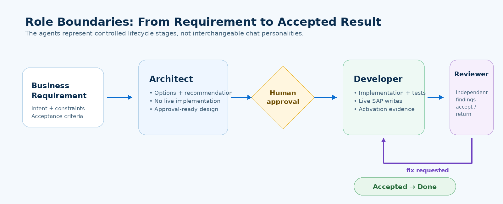

[Home - Agentic ABAP Workshop](../../README.md)

# Exercise 1: Verify Live Tool Access

## Introduction

Before allowing the AI development team to change the SAP system, you will use the **preinstalled** toolchain in read-only mode and verify that live evidence can be retrieved from the assigned S/4HANA system.

The goal of this exercise is **read-only evidence**. No SAP development object should be created or changed.

### Exercises

- [1.1 - Inspect the Available ADT MCP Capabilities](#exercise-11-inspect-the-available-adt-mcp-capabilities)
- [1.2 - Read the Live SAP Package with the Developer](#exercise-12-read-the-live-sap-package-with-the-developer)
- [1.3 - Verify Target-Aware SAP Standard Evidence](#exercise-13-verify-target-aware-sap-standard-evidence)
- [1.4 - Confirm the Role Boundaries](#exercise-14-confirm-the-role-boundaries)
- [Summary & Next Exercise](#summary--next-exercise)

> [!NOTE]
> Replace all occurrences of **`###`** with your participant suffix.

---

## Exercise 1.1: Inspect the Available ADT MCP Capabilities
[^Top of page](#)

> Ask the installed developer agent to discover the tools available in the current ADT session instead of assuming a fixed tool list.

<details>
  <summary>🔵 Click to expand!</summary>

1. Select **`abap-kebap-developer`** in the agent picker.
2. Enter the following prompt:

```text
Read workshop/participant.json.

Do not modify the SAP system.
Inspect the available ADT MCP capabilities in this session and group them by purpose:
- repository discovery/read
- create/edit
- check/activate
- ABAP Unit
- ATC
- RAP/service/generator operations

Report only capabilities that are actually available in this session.
```

3. Review the result. Tool names can differ between extension releases.

> [!IMPORTANT]
> Do not approve a write tool call in this exercise.

</details>

---

## Exercise 1.2: Read the Live SAP Package with the Developer
[^Top of page](#)

> Prove that the developer can retrieve live repository information without changing it.

<details>
  <summary>🔵 Click to expand!</summary>

Continue with **`abap-kebap-developer`** and run:

```text
Read workshop/participant.json.
Use ADT MCP read-only.

Confirm the configured SAP destination and participant package, then list up to ten repository objects currently visible in that package.
Do not create, edit, activate, delete, or change transport state.
Clearly state which evidence came from the live SAP system.
```

Expected result:

- the destination/package match your participant configuration,
- the package can be inspected,
- no object is modified.

</details>

---

## Exercise 1.3: Verify Target-Aware SAP Standard Evidence
[^Top of page](#)

> When the workshop environment provides `released-objects`, prove that release-status questions use evidence instead of model memory.

<details>
  <summary>🔵 Click to expand!</summary>

Ask the same developer agent:

```text
Do not modify the SAP system.

If the released-objects MCP is available in this workshop environment:
1. report dataset information with target resolution set to auto,
2. identify candidate SAP standard APIs or repository objects related to the current technical user / user context that could support an AssignToMe action,
3. return candidates and evidence only; do not select an implementation yet.

If released-objects is not part of this workshop environment, state that clearly and use only live-system compatibility evidence later in the architect step.
```

Discuss the difference:

| Question | Evidence source |
|---|---|
| What objects exist in my participant package? | ADT MCP / live SAP system |
| Is a SAP standard object appropriate for this target? | target-aware release evidence when available + live-system compatibility |

</details>

---

## Exercise 1.4: Confirm the Role Boundaries
[^Top of page](#)

> The three installed agents represent stages, not three interchangeable chat personalities.

<details>
  <summary>🔵 Click to expand!</summary>

Use the following mental model:



- The **architect** must not implement the live change.
- The **developer** is the role that performs workshop writes.
- The **reviewer** independently inspects the result and should not silently fix its own findings.

</details>

---

## Summary & Next Exercise
[^Top of page](#)

In this exercise, you have:

- discovered live ADT MCP capabilities,
- proven read-only SAP access,
- checked target-aware SAP standard evidence when available, and
- established the architect → developer → reviewer role boundary.

Continue with **[Exercise 2: Design the RAP Solution with the Architect](../ex02/README.md)**.
