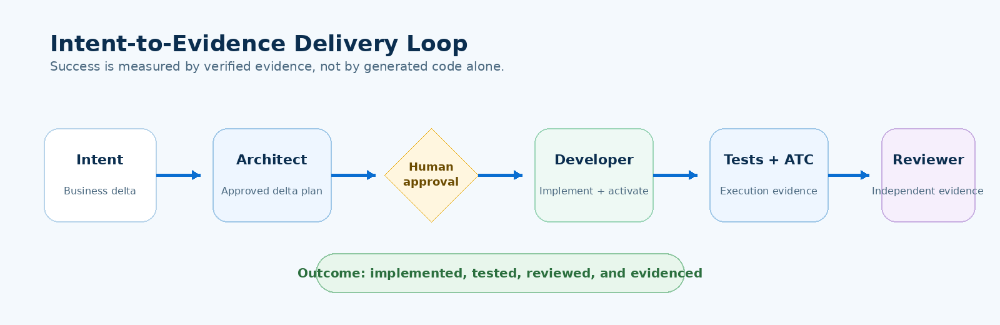

[Home - Agentic ABAP Workshop](../../README.md)

# Exercise 6: Intent-Only Team Challenge

## Introduction

This optional exercise tests the workshop goal: can you give the AI development team a **business intent** without prescribing the implementation?

### Challenge

> **Critical Service Requests must automatically receive a due date no later than two working days after creation. A Critical request must not be resolved without an assignee. The behavior must remain visible through the existing OData V4 UI service.**

### Exercises

- [6.1 - Ask the Architect for a Delta Design](#exercise-61-ask-the-architect-for-a-delta-design)
- [6.2 - Approve and Implement the Delta](#exercise-62-approve-and-implement-the-delta)
- [6.3 - Review the Result](#exercise-63-review-the-result)
- [Summary](#summary)

---

## Exercise 6.1: Ask the Architect for a Delta Design
[^Top of page](#)

<details>
  <summary>🔵 Click to expand!</summary>

Select **`abap-kebap-architect`** and paste only the challenge requirement above plus:

```text
Treat the existing Service Request app and approved design as the baseline.
Design the smallest safe delta for the connected SAP S/4HANA system. Do not assume Public Cloud.
Do not modify the SAP system.
Verify any new SAP standard dependency against the connected target; use released-objects target auto when applicable.
```

Review and approve the delta.

</details>

---

## Exercise 6.2: Approve and Implement the Delta
[^Top of page](#)

<details>
  <summary>🔵 Click to expand!</summary>

Switch to **`abap-kebap-developer`** and provide the approved delta, not implementation instructions.

The developer must:

- implement only inside the participant package,
- add or adapt ABAP Unit coverage,
- check and activate the changes,
- run the affected tests and quality checks.

> 💡 **Challenge card**: [sources/ex06_challenge-card.md](sources/ex06_challenge-card.md)

</details>

---

## Exercise 6.3: Review the Result
[^Top of page](#)

<details>
  <summary>🔵 Click to expand!</summary>

Switch to **`abap-kebap-reviewer`** and ask for an independent focused review of the delta and its evidence:

```text
Give me an independent, focused review of the delta in my participant package and of its evidence.

Delta: <paste the challenge requirement and the approved delta>

Do not modify the SAP system.
```

Success means the team completed this lifecycle:



</details>

---

## Summary
[^Top of page](#)

You have completed the full workshop lifecycle from **business intent** to **architecture**, **implementation**, **verification**, and **independent evidence**.

The key lesson is not that an LLM can write ABAP. It is that an ABAP developer can control a specialized AI team with explicit roles, reusable skills, live tool boundaries, and human approval gates.
